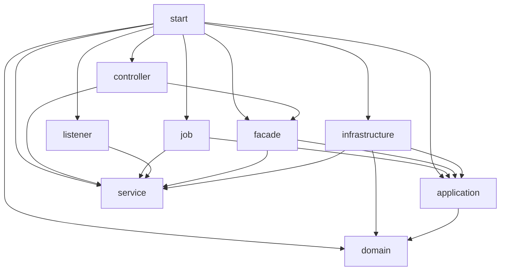

# DDD 渐进迁移架构

本次在 `DDDUpgrade` 分支将后端迁入九个 Maven 模块，并完成评论创建及分页查询试点。迁移前的 `pojo/common/server` 为历史布局，当前构建与运行入口均使用新模块。参照 `D:/devprojects/java-projects/dianping` 的模块组织与适配器模式，保留 Java 21 编译目标、Spring Boot 3.5.5、MyBatis-Plus 3.5.12，不移植教学项目的新功能或旧技术版本。

## 已确认范围

| 约束 | 内容 |
|---|---|
| 结构 | domain、application、infrastructure、facade、controller、job、listener、service、start |
| 方式 | 先安置旧代码，再迁移评论创建与分页查询 |
| 门面 | facade 依赖 application，提供业务入口与外部 DTO 转换 |
| 兼容 | 保持接口路径、响应格式、数据库表和 Redis 数据含义 |
| 后续功能 | 九模块和评论试点验收后，可在新分层开发新功能 |

## 实现约定

以下是为执行迁移作出的实现选择，不能理解为用户已确认全部业务的限界上下文。评论应用层按用户确认的 `comment.create/query/port` 组织，基础设施按 `persistence` 和 `identity` 组织，领域采用 `domain.comment`，门面保留 `facade.content.comment`；最终业务边界仍可调整。评论独立建模，以博客 ID 关联，不加载包含全部评论的大博客聚合。

| 模块 | 本次职责及依赖 |
|---|---|
| domain | 纯 Java 评论模型、内容值对象、领域错误、评论仓储契约；不依赖 Spring、MyBatis、HTTP 或遗留层 |
| application | 评论用例、事务编排、命令与查询模型、所需能力端口；依赖 domain，不依赖 infrastructure、service、facade |
| service | 合并旧实体、Mapper、服务、工具及暂未拆分的技术实现；不反向依赖新应用层 |
| infrastructure | 评论 DO、Mapper、仓储实现与能力适配器；博客、作者和身份仍复用遗留能力；依赖 domain、application、service |
| facade | 依赖 application、service；CommentFacade 调用新用例，兼容 Result、CreateCommentDTO、CommentVO 与 Page；不调用旧评论 Service |
| controller | 依赖 facade、service；HTTP Controller、JWT 过滤器、安全及异常适配；评论走 facade，其他入口暂时调用 service |
| job | 依赖 application、service；FeedTaskWorker 和评论计数同步各保持单份入口 |
| listener | 依赖 service；当前无生产类，预留消息入口；现有秒杀消费者留 service，保持生命周期 |
| start | 直接依赖其他八模块；唯一 Boot 可执行模块，CommentApplication、MapperConfiguration、运行 YAML、跨模块测试 |

暂未拆出的旧资源可跟随遗留层，运行 YAML 和启动类放 start。保持包名、Mapper XML namespace、Lua 路径及配置语义。不删除文件或目录：源文件使用保留内容的移动，原 POM 可重用为新模块 POM；构建不使用 clean。架构试点阶段未提交或推送；后续功能提交独立遵守对应工作范围。

### 实际生产依赖方向

以下箭头表示模块直接依赖；测试依赖不在图中。domain 无生产依赖，application 的外部生产依赖仅为 spring-context 和 spring-tx。service 不依赖其他项目模块；父 POM 管理版本与插件，不向内层添加生产依赖。



facade 对 service 的依赖仅为本轮保持已有响应类型的过渡选择；不能因此让 application 引用旧实体、DTO、Result 或 MyBatis Page。只有 start 配置 Boot 重打包，其他有产物的模块为普通 JAR；空 listener 在当前 Maven 构建中可能不生成普通 JAR，因为没有可打包内容，不代表缺失运行类。

### 评论纵向链路

应用层业务包为 `com.dianping.application.comment`，按流程与能力分为 `create`、`query`、`port`。领域和门面分别采用 `com.dianping.domain.comment`、`com.dianping.facade.content.comment`，HTTP 入口仍位于原 `com.dianping.controller` 包。基础设施结构如下：

```text
infrastructure
├── persistence
│   ├── dataobject/comment/CommentDO.java
│   ├── mapper/comment/CommentMapper.java
│   ├── repository/comment/CommentRepositoryImpl.java
│   └── adapter/comment
│       ├── BlogCommentTargetAdapter.java
│       └── CommentAuthorDirectoryAdapter.java
└── identity/comment/CurrentCommentAuthorAdapter.java
```

`CommentDO` 映射原 `tb_blog_comments` 的全部字段，保留自增主键与时间默认值；新评论显式初始化点赞数、代次、版本和初始化标记；不承载业务规则。`CommentMapper` 继承 `BaseMapper<CommentDO>`。`CommentRepositoryImpl` 将领域评论转换成 DO 并保存，将分页 DO 转为应用读模型，同时实现 `CommentRepository` 和 `CommentReadPort`。

新评论仓储不再引用遗留 `BlogComments` 和 `BlogCommentsMapper`。两套映射访问同一张表，不复制数据、不创建新表；旧实体、Mapper、Service 及其测试继续保留。博客存在/计数和作者查询仍分别使用旧 `BlogMapper`、`UserMapper`；身份仍从 `UserHolder` 读取，分页大小仍用现有常量。因此 infrastructure 暂时继续依赖 service，service 不依赖 infrastructure，避免模块循环。

`start` 中的 `MapperConfiguration` 同时扫描 `com.dianping.mapper` 和 `com.dianping.infrastructure.persistence.mapper`，由启动类的组件扫描加载；H2 整链测试导入同一配置，不再手工注册 Mapper。未新增 Mapper XML，已有 XML 的路径和 namespace 保持不变。

```text
application.comment
├── create
│   ├── CreateCommentService
│   └── CreateCommentCommand
├── query
│   ├── QueryCommentsService
│   ├── CommentRow
│   ├── CommentAuthor
│   ├── CommentView
│   └── CommentPage
└── port
    ├── BlogCommentTarget
    ├── CurrentCommentAuthor
    ├── CommentReadPort
    └── CommentAuthorDirectory
```

`port` 集中声明应用服务需要的外部能力；查询端口使用 `query` 中的读模型作为数据契约。`CommentRepository` 仍是领域层的仓储契约，不迁入应用 `port`。基础设施实现上述接口，应用服务不依赖基础设施类。此次组织调整只改变包名和应用服务名称，保留方法签名、验证顺序、业务规则及事务边界。

| 层次 | 实际类型与作用 |
|---|---|
| HTTP 与门面 | BlogCommentsController → CommentFacade；保留原 DTO 校验，门面转换 Result、Page 与 CommentVO，仅将 CommentRuleViolation 转换为业务拒绝 |
| 创建应用服务 | CreateCommentService.create(CreateCommentCommand)；以 @Transactional 编排身份、内容、博客存在性、CommentRepository.insert 与计数，计数失败抛异常触发回滚 |
| 查询应用服务 | QueryCommentsService；经 CommentReadPort 查询 CommentPage/CommentRow，再经 CommentAuthorDirectory 批量补齐 CommentView，缺失作者仍保留记录 |
| 领域 | Comment、CommentContent、CommentRuleViolation、CommentRepository；纯 Java，独立于 Spring 和持久化对象 |
| 基础设施 | CommentRepositoryImpl 经 CommentMapper/CommentDO 实现仓储与读端口；BlogCommentTargetAdapter 适配博客存在/计数；CommentAuthorDirectoryAdapter 适配作者；CurrentCommentAuthorAdapter 适配 UserHolder |

创建时 Controller → facade → application；应用通过领域仓储契约调用基础设施的 CommentRepositoryImpl → CommentMapper → 原评论表，并通过 BlogCommentTarget 调用基础设施适配器 → service 中的 BlogMapper 增加计数。Spring 在 start 扫描装配实际实现。查询走独立读端口，不为查询重建聚合。旧 BlogCommentsServiceImpl 与其四个回归用例仍保留，评论 Controller 不再使用旧服务。

## 评论行为契约

- 保持 `POST /blog/{blogId}/comments`、`GET /blog/{blogId}/comments?current=1` 和原 HTTP/JSON 行为。
- HTTP 请求继续执行原始内容的 `@NotBlank`、`@Size(max=255)` 校验；领域内容采用现有 `String.trim()` 和 `String.length()`，非空且长度不超过 255，不能改成 Unicode 码点计数。
- 作者由服务端登录身份提供，不能采用客户端提交的用户 ID。
- 创建只支持已有一级评论，`parentId=0`、`answerId=0`、`status=0`；创建试点不新增回复和审核；后续点赞扩展见下文。
- 评论保存和博客评论计数 SQL 原子递增处于同一数据库事务；计数更新失败必须抛出异常，使评论插入回滚。
- 分页仅包含该博客下 `parent_id=0` 且 `status=0` 或 NULL 的评论，按创建时间和 ID 降序，分页大小为当前常量 10。
- 作者信息去重后批量查询，缺失作者仍保留评论；分页响应保持原 MyBatis-Plus 3.5.12 Page 的五字段 `records/total/size/current/pages` 及原 ISO 时间约定。内部应用模型不依赖 MyBatis Page。
- 不强造无实际职责的领域服务；查询采用读模型，无需重建聚合。

## 验收

1. 记录迁移前的全量 Maven 测试结果；外部 Redis/MySQL 专用测试的条件、跳过和已有问题单独列出。
2. 九个模块 reactor 构建通过，领域及应用层没有遗留或基础设施反向依赖。
3. 评论规则、分页及 HTTP 契约测试通过；用 H2 和真实 Spring 事务验证计数失败后评论回滚。
4. 全部原有可运行测试通过，Boot 可执行 jar 仅由 start 生成，运行文档和脚本路径同步更新。
5. 保留旧业务的 Feed 任务同事务写入、Lua 原子预占、数据库提交后 ACK 等行为。

默认测试、打包和实际启动命令见 [README](README.md)。领域与应用测试验证规则和编排，评论整链以 H2 MySQL 兼容模式、生产 Mapper、Spring 事务代理及真实 JWT/安全配置验证回滚与 HTTP 兼容；这不能证明 MySQL 的锁与隔离行为或真实 Redis 完整生命周期。本轮外部环境测试保持显式开关，不声称已验证生产 MySQL/Redis。

## 按试点迁移下一个业务

1. 读取根 CONTEXT 与相关 ADR，确认该业务目标、负责/不负责范围、规则、对外契约与未决边界；业务分包只是实现选择，完整限界上下文需单独确认。
2. 从现有 Controller/Service/Mapper 和回归测试提取原行为，先记录错误顺序、校验、事务、并发、缓存与外部生命周期约束。
3. 在 domain 建立有实际职责的模型和规则；在 application 建立命令、读模型、用例及必需端口，避免引用 service 或 infrastructure。
4. 在 infrastructure 复用或适配遗留持久化与技术能力；facade 保持原 DTO/响应，切换一个完整入口链路。Job/Listener 调用门面时仍保持原任务与消费者的单份装配及提交后 ACK 等时序。
5. 以规则、用例、真实事务和 HTTP 契约测试形成完整证据，运行全量测试、打包及资源检查，同时更新 CONTEXT 和重要 ADR。外部环境证据与离线证据分别记录。

## 遗留过渡职责与清理条件

service 当前仍提供未迁移业务、实体、DTO/VO、Mapper、工具、缓存、JWT 基础能力、技术配置及 Mapper XML/Lua/SQL；其中已有 Scheduled、PostConstruct 和秒杀消费者保持原生命周期。独立 FeedTaskWorker 已移至 job，不重复扫描；HTTP 与启动配置已分别归入 controller/start。

未来只有在旧能力全部调用方已迁入新入口、兼容响应已解耦、原契约和事务/并发回归通过、资源路径与装配生命周期核验完成后，才考虑收缩遗留依赖或清理旧实现。实际删除必须遵守 AGENTS.md 的确认流程；本次保留旧实现、历史目录及不属于新 reactor 的旧 target，不运行 clean。

九模块与评论试点验收后即可按新分层开发新功能，其余遗留业务按需迁移，不要求先迁完所有旧业务。任务引擎、保障申诉、MQ 不在本次实现范围；系统业务边界、后续迁移顺序及其他业务事务/协作仍为未决问题。

## 评论点赞扩展

| 层次 | 新增职责 |
|---|---|
| domain.comment | Comment 改为按已保存 ID 相等的实体；恢复真实父级与状态并检查资格。CommentLikeId、CommentLike 和 CommentLikeChange 表达单用户关系和切换，不加载所有点赞者 |
| application.comment.like | ToggleCommentLikeService 编排身份、路径归属、资格、已核对代次和关系切换；仅对确定未执行的状态竞争最多尝试三次 |
| application.comment.like.sync | SyncCommentLikeCountsService 编排快照、计数提交、条件确认与失败退避；逐条失败不阻断其他评论 |
| application.comment.query/port | 评论读模型新增 liked/isLike/likeAvailable；故障不伪装成未赞；能力契约保持在应用层 |
| infrastructure.redis.comment | Lua 原子切换、同槽待同步记录、批量状态读取、按版本 ACK 和退避；损坏/缺失暂停 |
| infrastructure.persistence | 评论真实恢复；持久化初始化标记与行锁；按恢复代次与版本提交绝对数量，提交完成后才允许 ACK |
| job.comment | 每秒调用应用同步服务，限量 100 条；入口不调用 Mapper 或 Redis |
| facade/controller/frontend | 新 POST 切换入口、503 错误；前端数量与颜色、防连点、禁止自动重放、失败后只读取恢复 |

新评论显式 liked=0、like_epoch=1、like_version=0、like_initialized=false。历史迁移默认代次 0，保留原数量；恢复与历史启用都需要核对，不自动归零。[部署与恢复](../docs/design/评论点赞部署与恢复.md) 说明增量 DDL、暂停开关、存储键及受控恢复工具。
